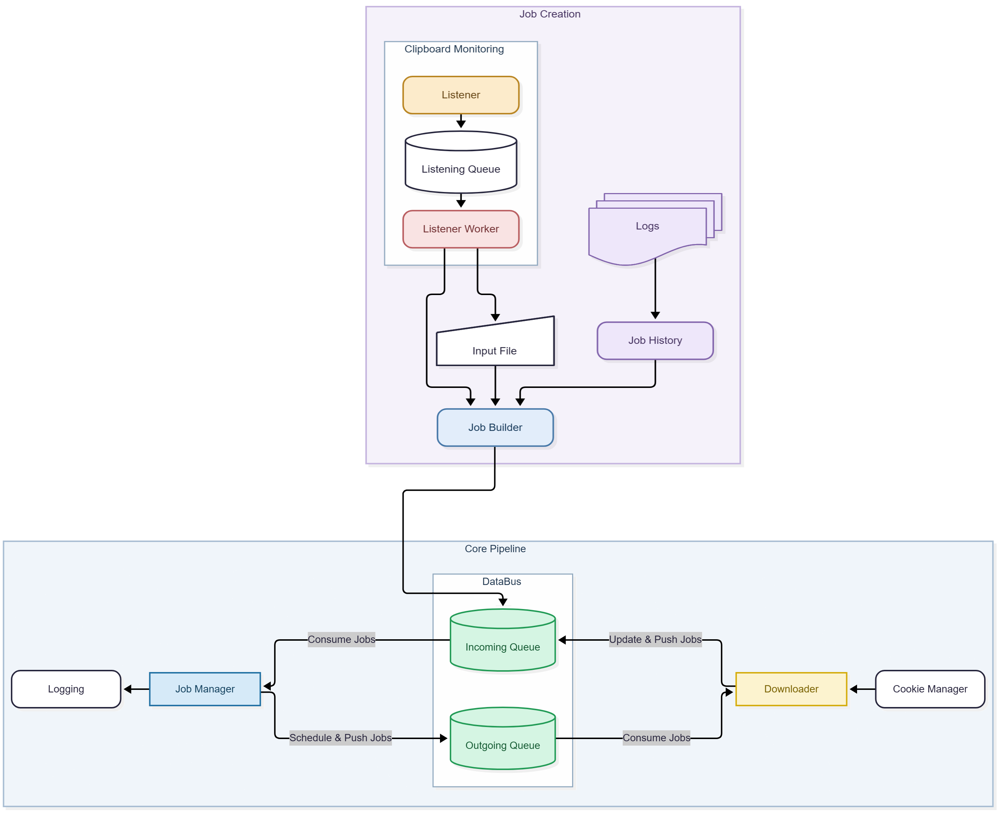

# Snatch DL

**Snatch DL** is a terminal-based download manager built on top of [yt-dlp](https://github.com/yt-dlp). It helps streamline the downloading process by monitoring your clipboard for links, organizing download tasks into a queue, and managing downloads in the background.

Designed with automation and maintainability in mind, Snatch DL brings together configurable settings, structured logging, cookie management, and concurrent download processing in one tool.

Whether you're looking to simplify repetitive downloads or explore how a C++ application can coordinate background tasks and external tools, Snatch DL provides a practical starting point.

For details about the underlying download engine and its supported sites, see the [yt-dlp repository](https://github.com/yt-dlp).

## Motivation

Existing download tools can make it difficult to balance automation, control, and visibility into the download process. I wanted to build a lightweight alternative that brings these aspects together without relying on a paid graphical interface.

Snatch DL was designed with a few goals in mind:

- **Organized download management** — schedule and manage download jobs through a queue.
- **Clear logging** — keep track of successful downloads, failures, and relevant events.
- **Flexible operation** — support separate clipboard-monitoring and direct-download modes, along with configurable command-line options.
- **Cookie management** — monitor cookie health, account for rate limits, and handle retries more reliably.

The goal is to make downloads easier to manage from the terminal while keeping the application transparent, configurable, and open to further development.

## Features

- **Clipboard Monitoring:** Automatically detects copied links and adds them to the download queue.
- **Concurrent Download Management:** Manages multiple download jobs concurrently through a dedicated job manager.
- **Automatic Retry Handling:** Retries failed jobs using different cookie strategies, with failures tracked separately for easier diagnosis.
- **Cookie Health Management:** Tracks cookie usage, applies cooldowns after failures, and avoids reusing cookies marked as unusable.
- **Structured Logging:** Maintains separate logs for successful and failed downloads, organized by source for easier troubleshooting.
- **Graceful Shutdown:** Handles Ctrl+C and supported terminal shutdown events to coordinate the shutdown of background threads and listeners.

## Architecture



For details, see [Architecture Documentation](docs/architecture.md) and [Workflows](docs/workflows.md).

## Getting Started

Snatch DL is currently intended for Windows. You can either download a precompiled release or build it from source.

### Requirements

- **Operating System:** Windows 10 or Windows 11.
- **For source builds:** CMake 3.15 or newer and a C++17-compatible compiler.
- **Download engine:** yt-dlp, included in the release package under `data/others`.
- **For authenticated downloads:** Cookies may be required for sites that need authentication.

### Option 1: Download a Release

The easiest way to get started is to download a precompiled release.

1. Open the Releases page.
2. Download the latest release ZIP.
3. Extract the archive to a folder of your choice.
4. Open Command Prompt or PowerShell in the extracted folder.
5. Run Snatch DL with a links file:
    
    ```
    .\app.exe links.txt
    ```
    
    The links file can be empty if you want to start with clipboard monitoring.
    

**Note:** Run Snatch DL from a terminal rather than double-clicking the executable, so you can provide command-line arguments and view its output.

### Option 2: Build from Source

Make sure CMake and a compatible C++ compiler are installed and available in your terminal.

Clone the repository:

```
git clone https://github.com/ChandraBhan07/snatch-dl.git
cd snatch-dl
```

Configure the project and build it:

```
cmake -S . -B build
cmake --build build --config Release
```

CMake will configure the project and invoke the selected build system. The executable's output location depends on the generator used.

Run `app.exe` from the appropriate output location, using a links file as an argument. For available commands and options, see Usage.


## Usage

Snatch DL runs from the command line and accepts an input file followed by optional flags to control how downloads are handled.

### Command Syntax

```
.\snatchdl <input-file> [options]
```

`<input-file>` specifies the file used to supply download links. The available options let you choose an operating mode, control download pacing, or display information about the application.

### Command-Line Options

#### Operating Modes

|Option|Description|
|---|---|
|`--listen-only`|Monitor the clipboard for URLs without downloading links from the input file.|
|`--download-only`|Download links from the input file without clipboard monitoring.|

#### Download Scheduling

|Option|Description|
|---|---|
|`--batch <count>`|Process at most the specified number of jobs per downloader cycle.|
|`--each-delay <seconds>`|Add a delay before processing each job.|
|`--start-delay <seconds>`|Delay the start of downloading once.|
|`--batch-delay <seconds>`|Add a delay before processing each batch.|

#### General Options

|Option|Description|
|---|---|
|`-h`, `--help`|Display the help message.|
|`-V`, `--version`|Display version information.|

### Examples

Run Snatch DL with an input file:

```
.\snatchdl links.txt
```

Monitor clipboard links only:

```
.\snatchdl links.txt --listen-only
```

Download links from the input file only:

```
.\snatchdl links.txt --download-only
```

Limit each downloader cycle to five jobs:

```
.\snatchdl links.txt --batch 5
```

Add a 10-second delay before each job:

```
.\snatchdl links.txt --each-delay 10
```

Wait 10 minutes before downloading starts:

```
.\snatchdl links.txt --start-delay 600
```

Add a 30-second delay before each batch:

```
.\snatchdl links.txt --batch-delay 30
```

Combine multiple options:

```
.\snatchdl links.txt --batch 5 --each-delay 10
```

### Notes

- Delay values are specified in seconds.
- `--batch` controls the maximum number of jobs processed per downloader cycle; it does not necessarily limit the total number of downloads.
- The input file argument is part of the command syntax, including when using an operating mode that doesn't download links from that file. Check the implementation for the precise requirements and behavior.


## Contributing

Contributions, suggestions, and bug reports are welcome. Whether you're fixing a bug, improving an existing feature, or exploring new functionality, please feel free to contribute.

### How to Contribute

1. Fork the repository and create a branch for your changes.
2. Make your changes and test them before submitting.
3. Open a pull request with a clear description of the changes and their purpose.

For larger changes, consider opening an issue first to discuss the proposed approach.

### Areas for Improvement

Some potential areas for future contributions include:

- **Cookie Management:** Improve cookie selection, health tracking, and handling of expired or unusable cookies.
- **Download Management:** Improve job scheduling, retry handling, and download tracking.
- **Logging and Diagnostics:** Improve error reporting and make download activity easier to investigate.
- **Cross-Platform Support:** Extend platform-specific functionality beyond Windows.

These are possible areas of improvement rather than a fixed roadmap. Contributions should align with the project's current architecture and goals.


## License

Snatch DL is distributed under the MIT License. See the license file for the applicable terms and conditions.

## Disclaimer

Snatch DL uses [yt-dlp](https://github.com/yt-dlp) as its underlying download engine. Snatch DL and yt-dlp are separate projects, and each is subject to its own applicable licensing terms.

This software is intended for lawful use. Users are responsible for ensuring that their downloading activities comply with applicable laws, copyright requirements, and the terms governing the content or services they access. The author does not endorse unauthorized downloading or misuse of the software.
    

